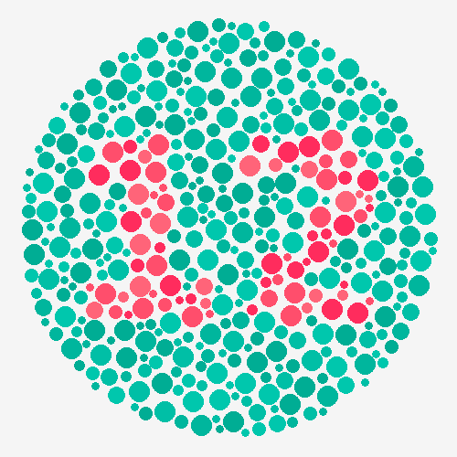
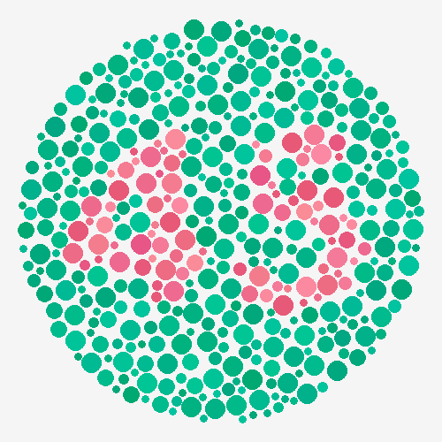
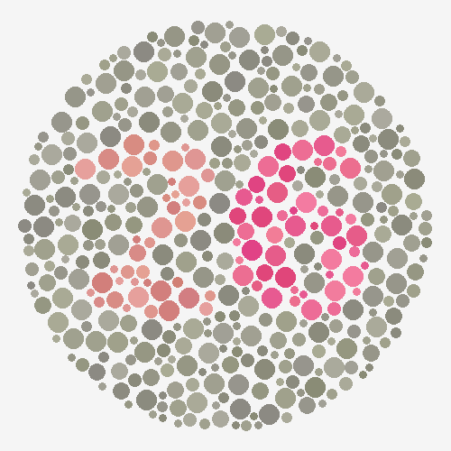
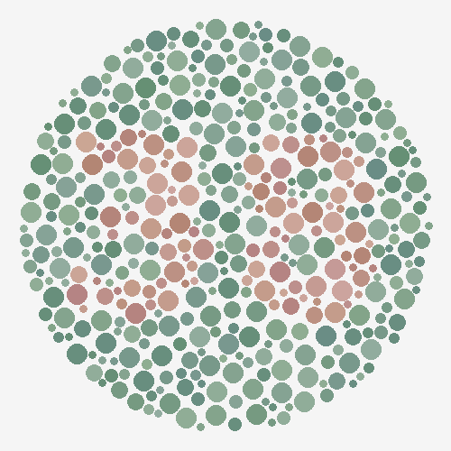
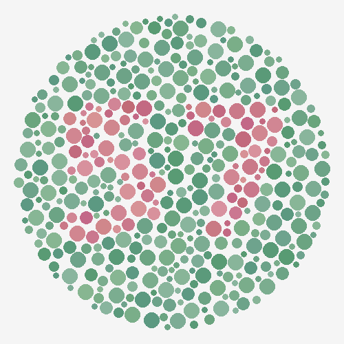
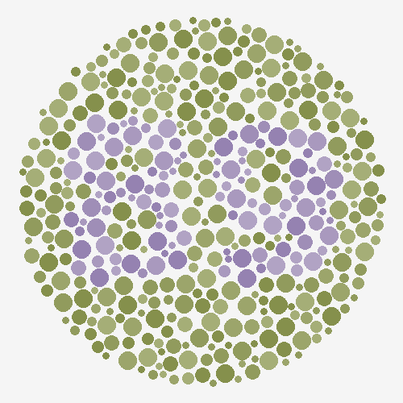

# Dailey's Color Vision Profile & Spectral-Notch Eyewear Guide

**Recorded:** October 20, 2026  
**Diagnosis:** **Protan (L-Cone / Long-Wavelength Red Deficiency — Protanomaly / Protanopia)**

---

## 1. LMS Cone-Confusion Diagnostic Test Results

Tested using 6 calibrated LMS cone-confusion pseudoisochromatic plates isolating the **L-cone ($\Delta L$, Protan)**, **M-cone ($\Delta M$, Deutan)**, and **S-cone ($\Delta S$, Tritan)** axes against randomized luminance noise:

| Plate | Target Number | Dailey's Response | Axis Tested | Diagnostic Takeaway |
| :--- | :---: | :---: | :--- | :--- |
| **Plate 1** (`plate_1_control.png`) | **12** | **12** | Baseline Control | Normal baseline visual acuity and contrast. |
| **Plate 2** (`plate_2_rg_screen.png`) | **45** | **45** | Combined $+\Delta L / -\Delta M$ | Intact M-cones easily detected the $-\Delta M$ green shift. |
| **Plate 3** (`plate_3_protan_deutan_split.png`) | **26** | **6** *(missed 2)* | Left (`2`) = Pure $\Delta L$ (Protan) Right (`6`) = Pure $\Delta M$ (Deutan) | **Definitive Protan Split:** Complete drop of the L-cone `2` while reading the M-cone `6` effortlessly. |
| **Plate 4** (`plate_4_protan_test.png`) | **38** | **Nothing** | Pure $\Delta L$ (Protan Axis) | Confirms strong L-cone (red wavelength) insensitivity. |
| **Plate 5** (`plate_5_deutan_test.png`) | **57** | **57** | Pure $\Delta M$ (Deutan Axis) | Confirms green M-cone channel is 100% intact. |
| **Plate 6** (`plate_6_tritan_test.png`) | **89** | **89** | Pure $\Delta S$ (Tritan Axis) | Confirms blue–yellow S-cone channel is 100% intact. |

### Reference Test Plates
| Plate 1 (Control: 12) | Plate 2 (Combined RG: 45) | Plate 3 (Protan/Deutan Split: 26) |
| :---: | :---: | :---: |
|  |  |  |

| Plate 4 (Protan Axis: 38) | Plate 5 (Deutan Axis: 57) | Plate 6 (Tritan Axis: 89) |
| :---: | :---: | :---: |
|  |  |  |

---

## 2. Optical Physics: Why Spectral-Notch Lenses Work for Protan Eyes

In **Protan** color vision:
1. **L/M Cone Spectral Overlap (540–585 nm):** The L-cone sensitivity curve is shifted toward shorter wavelengths (closer to the M-cone peak) or reduced in amplitude, causing yellow-green wavelengths (~550–585 nm) to stimulate both cones almost identically.
2. **Long-Wavelength "Red Dimming" (>610 nm):** Deep reds appear noticeably darker and muddier relative to greens and yellows.

### The Golden Rules for Choosing Lenses as a Protan:
* **Rule 1 — Demand Spectral Notch Filtering (~560–585 nm):** Lenses like **Oakley Prizm**, **Maui Jim PolarizedPlus2**, **Costa 580**, **Smith ChromaPop**, and **Serengeti Spectral Control** use narrow-band dyes or rare-earth neodymium to carve out the 560–585 nm yellow-green overlap zone. Removing that middle overlap forces the remaining green (~530 nm) and red (>600 nm) signals further apart.
* **Rule 2 — Always Choose Rose, Copper, or Warm Bronze Base Tints:** Rose and Copper bases attenuate mid-spectrum green/yellow light while transmitting long-wavelength red photons freely—counteracting Protan "red dimming."
* **Rule 3 — Beware the "Mirror Paradox" (Avoid Heavy Red Mirrors):** A bright red/orange outer mirror (*Oakley Ruby/Torch*, *Smith Red Mirror*) looks red from the outside because it **reflects red wavelengths away from your eye**, leaving a cooler greenish-teal interior cast. Conversely, **Blue, Violet, Green, or Rose Gold outer mirrors** on top of a **Rose/Copper base** reflect blue/green glare away and pass warm red light straight through to your L-cones.

---

## 3. Oakley Prizm Polarized Sunglasses — Ranked for Protan Vision

| Rank / Use Case | Oakley Lens Name | Base Tint | VLT | Why It Works for Protan Vision |
| :--- | :--- | :--- | :---: | :--- |
| **#1 Everyday & Driving** | **Prizm Daily Polarized** *(or **Prizm Rose Gold Polarized**)* | Warm Rose | `14%` *(`13%`)* | Suppresses the 540–570 nm yellow-green overlap while letting deep reds and blues through. Brake lights, brick, skin tones, and red/orange details pop against green trees and asphalt. |
| **#1 Bright Sun, Beach & Water** | **Prizm Deep Water Polarized** | Rose | `12%` | Built on a **high-contrast Rose base** (despite its blue-silver outer mirror). Cuts harsh ocean glare while keeping far better red-green separation than Grey-based `Prizm Black` or `Prizm Sapphire`. |
| **#1 Trails, Golf & Warm Contrast** | **Prizm Tungsten Polarized** | Warm Bronze | `14%` | Boosts long-wavelength reds and ambers while cutting blue/green clutter. Separates soil, bark, and browns from green foliage. |
| **Non-Polarized Sport Bonus** | **Prizm Field** / **Prizm Trail Torch** | Rose / Berry | `15%` / `35%` | Aggressive rose spectral notches that act like supercharged red-boosters on grass, dirt, and trails. |

* **Oakley Sunglasses to Skip as a Protan:**
  * **Prizm Ruby Polarized (`17% VLT`):** Red/orange outer mirror reflects red light away, leaving a cooler greenish-yellow interior view.
  * **Prizm Black Polarized (`11% VLT`):** Neutral Grey base dims all wavelengths evenly without boosting red-to-green contrast.

---

## 4. Other Sunglasses Brands with Spectral Notch Filtering

| Brand & Tech | How It Works | Best Tint for **Protan** Vision |
| :--- | :--- | :--- |
| **Maui Jim** *(PolarizedPlus2® — SuperThin Glass)* | Uses three **rare-earth elements** (neodymium, erbium, praseodymium) in mineral glass to cut a razor-sharp notch at the ~580 nm yellow spike. | **Maui Rose®** *(1st choice — warm rose base)* **HCL® Bronze** *(2nd choice — warm bronze base)* |
| **Costa Del Mar** *(580G Glass / 580P)* | Named **"580"** because rare-earth filters block harsh yellow light at **580 nm** while boosting red, green, and blue peaks. | **Copper** or **Copper Silver Mirror** *(12% VLT)* **Sunrise Silver Mirror** *(25% VLT — low light)* |
| **Smith Optics** *(ChromaPop™ Polarized)* | Dual spectral notches (~485 nm cyan and ~570 nm yellow-green) to prevent L/M cone confusion. | **ChromaPop Ignitor** *(rose-copper base)* or **ChromaPop Rose Gold / Bronze Mirror** |
| **Serengeti** *(Spectral Control® Glass)* | Neodymium spectral notch filtering + polarization + photochromic auto-darkening in borosilicate glass. | **Sedona®** *(high-contrast Rose base)* or **Drivers®** *(warm amber-copper)* |
| **Bollé** *(Volt+™ High Contrast)* | AI-formulated high-contrast dye targeting a deep notch in the red-green crossover band. | **Volt+ Ultraviolet Polarized** or **Volt+ Offshore Blue** *(rose/amber bases)* |
| **Bajío** *(LAPIS™ Technology)* | Blocks 95% of blue light up to 445 nm plus the 580 nm yellow-green confusion spike. | **Rose Mirror** or **Violet Mirror** *(Rose/Copper base)* |
| **EnChroma®** *(Cx3 Sun SP — Strong Protan)* | Purpose-built colorblindness multi-notch filter; the **`SP` (Strong Protan)** series shifts the notch and increases red transmission specifically for L-cone deficiency. | **Cx3 Sun SP (Strong Protan)** |

---

## 5. Snow Goggles Guide: Oakley Prizm Snow & Smith ChromaPop Snow

Because snow goggle mirrors strongly alter interior spectral transmission (the **Mirror Paradox**), avoid heavy red mirrors (*Oakley Torch*, *Smith Red Mirror*) and choose **Rose/Copper bases paired with Blue, Violet, Green, Rose Gold, or No Mirror**.

### Oakley Prizm Snow — Ideal 2-Lens Quiver
1. **Everyday / Sun (`13% VLT`):** **Prizm Snow Sapphire Iridium** *(or **Prizm Snow Rose Gold Iridium**)*
   * Blue outer mirror reflects blue glare while the warm **Rose/Amber base** sends maximum red/orange light to your eyes.
2. **Single-Lens All-Rounder (`21% VLT`):** **Prizm Snow Rose**
   * Zero mirror—100% pure Prizm Rose notch dye.
3. **Storm / Flat Light / Whiteout (`46% / 39% VLT`):** **Prizm Snow Hi Pink Iridium** (`46%`) or **Prizm Snow Persimmon** (`39%`).
* *Skip:* `Prizm Snow Torch Iridium` (red mirror reflects red away) and `Prizm Snow Iced Iridium` (cool teal cast).

### Smith ChromaPop Snow — Ideal MAG 2-Lens Bundle
1. **Everyday / Sun (`22–23% VLT`):** **ChromaPop Everyday Rose Gold Mirror**, **Everyday Violet Mirror**, or **Everyday Green Mirror**
   * Reflects blue/green glare off the front while keeping a warm, red-rich rose-amber view inside.
2. **Photochromic Option (`30–50% VLT`):** **ChromaPop Photochromic Rose Flash**
3. **Storm Lens (`50% VLT`, included in MAG box):** **ChromaPop Storm Rose Flash**
* *Skip:* `ChromaPop Everyday Red Mirror` and `ChromaPop Sun Red Mirror` (leaves a cool grey-teal interior view).

---

## 6. Where to Try & Buy These on Kauai, Hawaii

If you're on Kauai and want to test **Oakley Prizm (Daily / Rose Gold / Deep Water / Tungsten)**, **Maui Jim (Maui Rose / HCL Bronze)**, **Costa 580G (Copper Silver Mirror)**, and **Smith ChromaPop** side-by-side outdoors in tropical sun and ocean glare:

### South Shore (Poʻipu / Koloa) — *Best Concentration of Selection*
1. **The Shops at Kukuiʻula** *(2829 Ala Kalanikaumaka St, Koloa)*
   * **Sunglass Hut:** Carries the deepest selection of **Oakley Prizm Polarized** (including Prizm Deep Water, Prizm Tungsten, Prizm Rose Gold, and Prizm Daily), **Maui Jim** (Maui Rose & HCL Bronze in SuperThin Glass), and **Costa 580G**—and lets you step right outside into bright sun with palm trees and red flowers to test cone separation.
2. **Nukumoi Surf Co.** *(2080 Hoone Rd, Poipu — right across from Brenneke's Beach)*
   * Awesome local surf shop carrying sport frames from **Oakley**, **Smith (ChromaPop)**, **Maui Jim**, and **Costa**.
3. **Grand Hyatt Kauai Resort & Spa** *(1571 Poipu Rd, Koloa)*
   * Has a resort **Sunglass Hut** boutique in the lobby shopping promenade with curated Oakley Prizm Water/Lifestyle and Maui Jim lines.
4. **Poʻipu Surf** *(Poipu Shopping Village, 2360 Kiahuna Plantation Dr)*
   * Good spot for **Smith ChromaPop**, **Oakley**, and **Maui Jim** surf/lifestyle frames.

### Central / East Side (Līhuʻe & Kapaʻa)
1. **Kukui Grove Center** *(3-2600 Kaumualii Hwy, Lihue)*
   * **Sunglass Hut** *(Mall Center)*: Full mainland-style inventory of **Oakley Prizm** and **Maui Jim**.
   * **Déjà Vu Surf Hawaii** *(inside Kukui Grove)*: Great local retailer stocking **Oakley**, **Smith**, and **Maui Jim** sport/surf models.
2. **Costco Kauai** *(4300 Nuhou St, Lihue)*
   * Always check the optical counter near the entrance—Kauai Costco routinely stocks authentic **Maui Jim PolarizedPlus2** (often including *Maui Rose* and *HCL Bronze* in SuperThin Glass) and occasional **Oakley Prizm Polarized** / **Costa 580** models for `$100–$120` vs. `$280+` retail.
3. **Tamba Surf Company** *(4-1543 Kuhio Hwy, Kapaa)*
   * Core local surf shop on Kuhio Hwy carrying performance **Oakley**, **Smith**, and **Maui Jim** shades.

### North Shore (Princeville & Hanalei)
1. **Princeville Shopping Center** *(5-4280 Kuhio Hwy, Princeville)*
   * **Sunglass Hut:** Best North Shore stop for comparing **Oakley Prizm** vs. **Maui Jim** vs. **Costa**.
2. **Hanalei Surf Co.** *(5-5161 Kuhio Hwy, Hanalei — across from Hanalei Center)*
   * Legendary North Shore surf shop carrying **Smith ChromaPop**, **Oakley Prizm**, **Maui Jim**, and **Costa** waterman frames.

---

## 7. Cortical Processing: Why the Parvocellular ($L - M$) Pathway Reacts So Strongly

*[Peer-to-peer neuro-ophthalmic summary & narrated 1080p video (`./assets/protan_prizm_neuro_optics.mp4`):]*

> V1 and the parvocellular pathway don't actually care about raw L or M cone photon counts—they compute the **opponent difference signal ($L - M$)**.
> - When someone with normal trichromacy puts on a Prizm lens, their $L - M$ opponent channel is already operating near full dynamic range, so their visual cortex just interprets the lens as a pleasant, slightly warmer saturation boost (~10–15% more pop).
> - In Dailey’s visual cortex, because his L and M inputs are normally correlated by that 550–585 nm overlap, his parvocellular $L - M$ opponent neurons spend his whole life firing near baseline noise—forcing his brain to rely almost entirely on the magnocellular luminance ($L + M$) and blue-yellow ($S - (L+M)$) pathways to find edges and depth. Meanwhile, cortical gain control ("von Kries adaptation") is cranked all the way up on that weak $L - M$ channel, waiting for a differential signal.
> - The moment a Rose/Copper notch lens strips out the 560–585 nm common-mode noise and boosts relative red luminance, it feeds a clean differential into that high-gain $L - M$ pathway. Within seconds, chromatic adaptation normalizes the rose cast of the lens so "white" looks white again, and his visual cortex suddenly gets **chromatic edge and depth segregation** where objects previously had zero luminance contrast (like red flowers or brown dirt against green foliage). To his brain, things don't just look "tinted"—objects literally separate into distinct planes.
